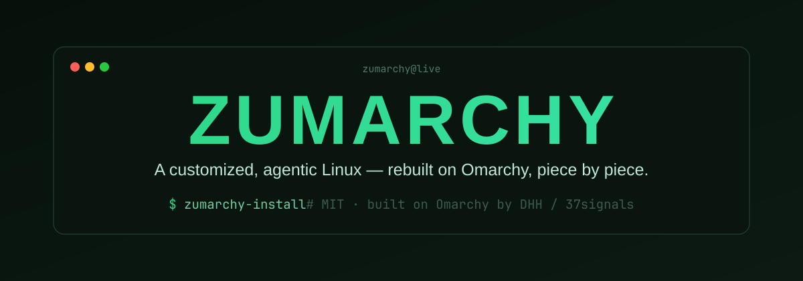
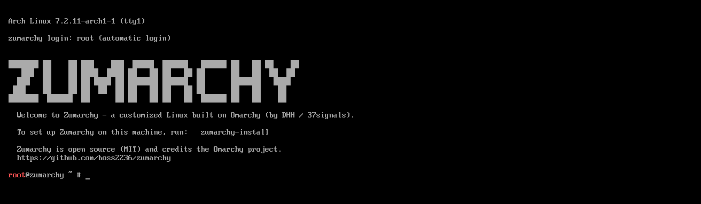

<p align="center">
  
</p>

<p align="center">
  <a href="https://opensource.org/licenses/MIT"></a>
  
  
</p>

**Zumarchy** is a beautiful, fun & agentic Linux distribution — a customized fork of [Omarchy](https://omarchy.org) (by DHH / 37signals), rebuilt and tailored piece by piece.

> **Credit & attribution.** Zumarchy stands entirely on the shoulders of **Omarchy**. All of the original foundation, tooling, design, and the desktop itself are the work of the Omarchy project (DHH / 37signals). Zumarchy only layers its own branding and customizations on top. Huge thanks to the Omarchy team — learn about the original at [omarchy.org](https://omarchy.org).

---

## What is Zumarchy?

Zumarchy is Omarchy's clean, modern Arch + Hyprland desktop, re-skinned and being rebuilt into its own thing. It keeps Omarchy's strengths — a fast agentic workflow, a gorgeous Wayland desktop, and sane defaults — while carrying its own identity. Because it tracks Omarchy upstream, it keeps inheriting their improvements.

## Screenshots

<p align="center">
  
  <br><em>The Zumarchy live/install medium booting.</em>
</p>

## Install

Grab the Zumarchy ISO (or build it yourself — see below), write it to a USB stick, and boot it:

```bash
# write the image to a USB drive (replace sdX with your device!)
sudo dd if=zumarchy-*.iso of=/dev/sdX bs=4M status=progress oflag=sync
```

From the live environment, start the guided bootstrap:

```bash
zumarchy-install
```

## Build the ISO yourself

Zumarchy ships an [`archiso`](https://wiki.archlinux.org/title/Archiso) profile under [`iso/`](iso/):

```bash
sudo pacman -S --needed archiso
sudo mkarchiso -v -w /tmp/zumarchy-work -o ./out iso/profile
# -> ./out/zumarchy-<version>-x86_64.iso
```

## Build / run from source

The whole system is a layer of shell scripts, configs, and the `omarchy-*` CLI:

```bash
git clone https://github.com/boss2236/zumarchy
export OMARCHY_PATH="$PWD/zumarchy"
export PATH="$OMARCHY_PATH/bin:$PATH"
omarchy-show-logo      # say hello
```

## The Zumarchy Manual

The manual lives in [`manual/`](manual/), which is its authoritative source.

- [Welcome](manual/01-welcome-to-omarchy.md) · [Getting Started](manual/02-getting-started.md) · [Navigation](manual/04-navigation.md) · [The top bar](manual/05-the-top-bar.md) · [Themes](manual/06-themes.md) · [Hotkeys](manual/07-hotkeys.md)
- [Applications](manual/15-terminal.md) · [AI](manual/17-ai.md) · [Development Tools](manual/18-development-tools.md) · [Web Apps](manual/25-web-apps.md) · [Gaming](manual/26-gaming.md)
- [Updates](manual/30-updates.md) · [Monitors](manual/33-monitors.md) · [Networking](manual/35-networking.md) · [Branding](manual/41-branding.md) · [Making your own theme](manual/43-making-your-own-theme.md)
- [Troubleshooting](manual/45-troubleshooting.md) · [FAQ](manual/46-faq.md) · [Security](manual/48-security.md)

## Credit & License

Zumarchy is a fork of **Omarchy** (© the Omarchy authors, DHH / 37signals) and, like Omarchy, is released under the [MIT License](https://opensource.org/licenses/MIT). All original work remains theirs; Zumarchy's customizations are offered under the same license. With gratitude to the Omarchy project. 💚
